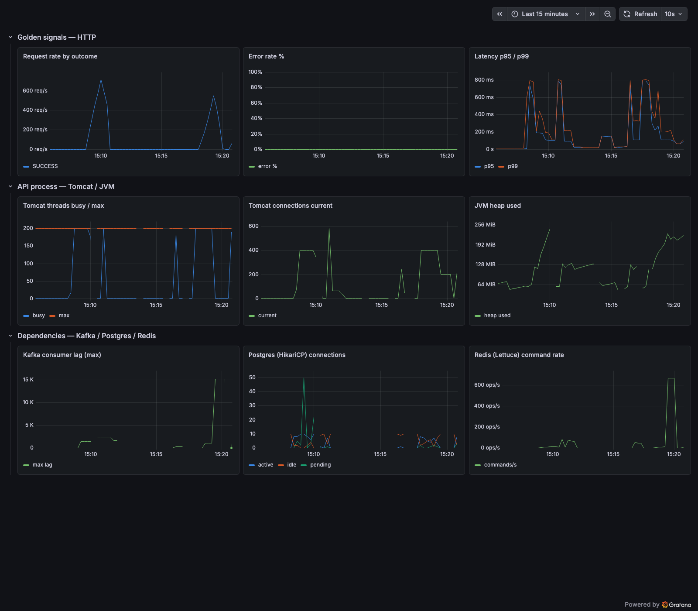
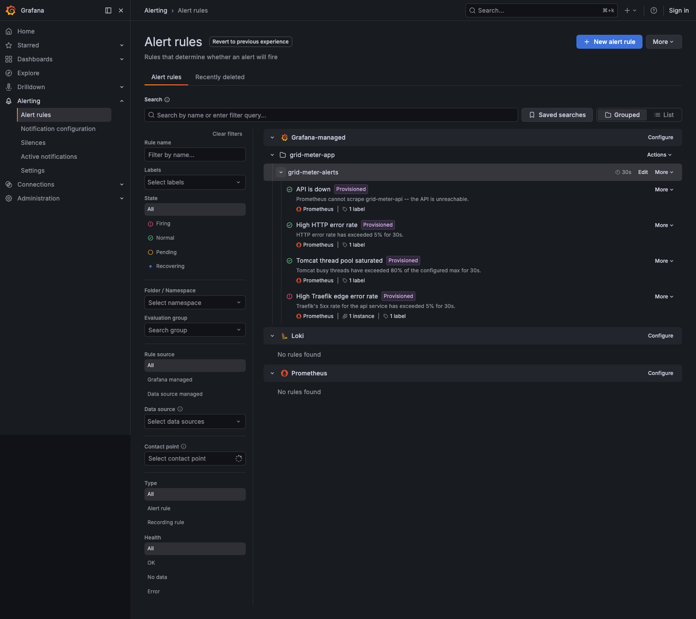

# grid-meter-app

A smart-grid-meter simulation built to demonstrate **SRE practice**:
observability, alerting, chaos and failover testing, load testing, CI/CD, and
multi-cloud infrastructure as code.

The application itself is deliberately small (CRUD + search on meters and their
readings) so the effort goes into the SRE work: making the system observable,
proving it survives failure, and running it reliably and cheaply.

**Stack:** Java 25 / Spring Boot 4.1 · React 19 · Traefik 3.7 · Kafka 4.3 (KRaft)
· PostgreSQL 18 (Patroni HA) · Redis 8 (Sentinel HA) · Prometheus · Grafana ·
Loki · Tempo · Alloy · Kubernetes (kind, EKS, GKE, AKS) · Terraform · GitHub
Actions. Pinned versions and the reasoning behind each:
[docs/tech-stack-versions.md](docs/tech-stack-versions.md).

---

## Dashboards

### Grafana: six focused dashboards

Each dashboard answers one question and fits on one screen with no scrolling,
so it stays quick to load while the system is under heavy load and a
screenshot keeps full detail. A link bar at the top of each one jumps to the
others.

| Dashboard | Panels | Question it answers |
|---|---|---|
| **SLOs** | Availability and latency SLIs, error budget left (7 days) · SLI trend vs SLO and an illustrative SLA · Error-budget burn rate | Are we meeting our reliability targets, and how fast are we spending the budget? |
| **Service Health** | Active users · Services ready (UP / DOWN per workload) · Container restarts · Logins per minute | Is everything running, is anything crashing, are users getting in? |
| **Logins** | Recent logins (newest first) · Logins per user · Failed logins by attempted username | Who is logging in, and is anyone guessing passwords? |
| **Golden Signals** | Request rate by outcome · Error rate % · Latency p95 / p99 | Are users being served, correctly and quickly? |
| **API Process** | Tomcat threads busy / max · Current connections · JVM heap used | Is the API process itself running out of headroom? |
| **Dependencies** | Kafka consumer lag · HikariCP connections (active/idle/pending) · Redis command rate | Is a downstream dependency the bottleneck? |

Under load, during an autoscaling test (two traffic spikes, API scaled out and
back in), shown in the earlier single-dashboard layout:

The dashboards are provisioned from code
([observability/dashboards/](observability/dashboards/)), not hand-built in
the UI, so every environment gets the same view. Logs (Loki) and traces
(Tempo) are wired in as Grafana datasources alongside Prometheus. Service
Health's up/down and restart panels come from kube-state-metrics, so they're
populated on Kubernetes only.

### Alerting

Alert rules are Grafana-managed and provisioned from
[observability/alerting/rules.yml](observability/alerting/rules.yml), in one
group per dashboard. Each rule is linked to the panel that shows its signal,
so the panel displays the alert's state and the alert links back to the panel:

| Group | Alert | Severity | Fires when | For |
|---|---|---|---|---|
| SLO | Availability SLO: fast / slow error-budget burn | critical / warning | 5xx at the edge burning the 99.5% budget at 14.4x (1h and 5m) or 6x (6h and 30m) | 2m |
| | Latency SLO: fast / slow error-budget burn | critical / warning | Requests over 500ms burning the 99% budget at the same rates | 2m |
| Service health | Service down | critical | A workload has no ready replicas (Kubernetes) | 30s |
| | Service degraded | warning | Fewer ready replicas than desired (Kubernetes) | 2m |
| | Service crashed and restarted | warning | Any container restart in the last 10 minutes (Kubernetes) | — |
| Golden signals | API is down | critical | Prometheus can't scrape the API | 30s |
| | High HTTP error rate | warning | 4xx + 5xx above 5% of requests | 30s |
| | High Traefik edge error rate | warning | Edge 5xx above 5%, catching failures the app itself never sees | 30s |
| API process | Tomcat thread pool saturated | warning | Busy threads above 80% of max | 30s |
| | JVM old-gen heap trending toward exhaustion | info | `predict_linear` projects exhaustion within 7 days | 5m |
| Dependencies | Reading delivery failures | info | A reading was permanently lost after Kafka retries were exhausted | 30s |

### Service level objectives

| SLI | Measured at | SLO (7-day rolling) | Error budget |
|---|---|---|---|
| Availability: API requests not answered with a 5xx | Traefik edge, so failures the app never sees still count | 99.5% | 0.5%, about 50 minutes of full outage per week |
| Latency: API requests served in under 500ms (health checks excluded) | The app (Micrometer, with an exact 500ms histogram bucket) | 99% | 1% of requests may be slower |

The 500ms latency target matches the load tests' p95 ceiling. The SLOs dashboard also shows an
illustrative **99% SLA**. The app has no customer contract, but an SLA is always looser than the
SLO, so a problem is caught internally before a contract would be breached. The burn-rate alerts
follow the multiwindow method from Google's SRE Workbook: a long window proves the problem is
significant, a short one proves it's still happening, and a minimum request count keeps a single
failure on a quiet demo from paging.

On Kubernetes, `kube-prometheus-stack`'s ~155 built-in Prometheus alerting rules are
turned off. With no Alertmanager they could notify no one, and on kind 13 of
them fired falsely because kind's control plane can't be scraped.

The edge alert exists because a real chaos test showed an outage the app-level
alert couldn't see: requests failing at Traefik never reach the API's own
metrics. Verified firing:

### Opening the dashboards locally

Start the full stack with `docker compose up` (from this directory), then:

| UI | URL | Notes |
|---|---|---|
| Grafana | http://localhost/grafana (or http://localhost:3001) | Anonymous access, local only |
| Prometheus | http://localhost/prometheus | |
| Traefik dashboard | http://localhost:8080/dashboard/ | Routers, services, health checks |
| Consul (Patroni's consensus store) | http://localhost:8500 | |
| The app | http://localhost | Log in as `demo` / `GridMeter!Demo2026` (local seed user) |

On Kubernetes, the same dashboards and alerts are installed by
[k8s/deploy-observability.sh](k8s/deploy-observability.sh) via
`kube-prometheus-stack`. See [k8s/README.md](k8s/README.md).

> **Cloud demo:** the scheduled AWS deployment currently serves the app only.
> Publishing Grafana read-only from the cloud environment is planned.

---

## Reliability engineering

### Chaos and failover testing

Each data-tier component runs highly available, and each HA layer was proven by
breaking it on purpose and measuring recovery:

- **Kafka**: 3 brokers, KRaft controllers; leader-failover RTO measured at
  0.098–0.167s ([docs/ha-scope.md](docs/ha-scope.md))
- **PostgreSQL**: Patroni + Consul, quorum synchronous replication; primary,
  replica, Consul-partition and quorum-loss scenarios
  ([docs/postgres-ha-scope.md](docs/postgres-ha-scope.md))
- **Redis**: Sentinel failover and quorum-loss tests
  ([docs/redis-ha-scope.md](docs/redis-ha-scope.md))
- **App resilience**: per-dependency circuit breakers, load-tested under a
  sustained Kafka outage ([docs/resilience-scope.md](docs/resilience-scope.md))

[load-tests/chaos-demo.sh](load-tests/chaos-demo.sh) takes down Traefik, the
API, a Kafka broker, a Patroni node and Redis in turn, capturing the dashboard
and alert state at each outage and recovery
([screenshots](load-tests/screenshots/chaos-demo-20260904-131859/)).

Two lessons from this work shaped how the project tests everything:

1. **Durability settings are undeclared defaults until checked live.** Nine
   separate settings (Kafka `acks`, Postgres `synchronous_standby_names`,
   Redis `min-replicas-to-write`, ...) were silently at "no real guarantee"
   until verified against the running system.
2. **A chaos-tested cluster isn't a protected application.** Postgres passed six
   stages of failover testing while the app was still pointed at a standalone
   database. Every HA layer now ends with a failure test driven through the
   app's real endpoints.

Upstream bugs found along the way are archived with reproductions in
[load-tests/vendor-bug-reports/](load-tests/vendor-bug-reports/).

### Load testing

JMeter profiles with automated pass/fail gates (error rate < 1%, p95 ceiling)
in [load-tests/](load-tests/README.md). Full-scale results:

| Profile | Samples | Error rate | p95 |
|---|---|---|---|
| steady-state | 28,441 | 0% | 11ms |
| ramp-up | 165,241 | 0.0006% | 10ms |
| rapid-spike | 348,697 | 0% | 164ms |
| gentle-spike (1 replica) | 92,034 | 0% | 795ms |
| soak (1 hour) | 340,304 | 0.031% | 8ms |

Soak's only errors are a burst of 401s at exactly 60 minutes: the JWT's
documented one-hour TTL expiring, not a leak. Explained in the load-test README.

### Incidents and postmortems

Real incidents on the cloud deployment are written up in the dated status logs.
For example, [2026-10-09](status/claude_code_2026-10-09.md):

- **A 5-hour outage with every health check green.** Fargate scheduled the
  ingress pod into an availability zone the load balancer didn't serve. Found
  via NLB target health, fixed by pinning ingress to a single-AZ Fargate
  profile, and the health check was hardened from one attempt to a 2-minute
  poll.
- **An orphaned, still-billing EKS cluster.** An interrupted `terraform destroy`
  left it behind, and the teardown's "anything to destroy?" check gave a false
  negative. Fixed by checking real state (`terraform state list`) instead of
  Terraform outputs.

---

## Operations

### CI/CD

GitHub Actions workflows live at the repo root
([.github/workflows/](../.github/workflows/)):

| Workflow | Runs | Purpose |
|---|---|---|
| `grid-meter-app-ci.yml` | Every push / PR | Unit + component tests (Testcontainers), black-box API tests against a deployed stack, frontend build. Required checks on `main`. |
| `grid-meter-app-e2e.yml` | Push | Playwright end-to-end suite, including the Grafana dashboard, on a self-hosted runner |
| `grid-meter-app-load-test.yml` | Nightly + on demand | JMeter with threshold gates |
| `grid-meter-app-aws-startup.yml` / `-teardown.yml` | Daily schedule | Bring the AWS environment up in the morning and destroy it at night |

### Cost control

The cloud environment exists only during demo hours. A scheduled startup builds
it from Terraform, deploys, seeds data and runs an end-to-end login check; a
nightly teardown destroys everything except one persistent Elastic IP. Both
are idempotent and skip cleanly when there's nothing to do.
[terraform/aws/check-costs-aws.sh](terraform/aws/check-costs-aws.sh) cross-checks
Cost Explorer after teardown to confirm nothing was left billing.

### Multi-cloud infrastructure as code

Parallel Terraform configurations, each deployed live and torn down:

| | Kubernetes | PostgreSQL | Redis |
|---|---|---|---|
| [AWS](terraform/aws/README.md) | EKS | RDS | ElastiCache (Valkey) |
| [GCP](terraform/gcp/README.md) | GKE | Cloud SQL | Memorystore |
| [Azure](terraform/azure/README.md) | AKS | Azure Database for PostgreSQL | Azure Cache for Redis |

Each cloud's managed Redis uses IAM / workload-identity auth rather than
static passwords. Design rationale:
[docs/cloud-deployment-scope.md](docs/cloud-deployment-scope.md).

---

## Further reading

- [docs/architecture.md](docs/architecture.md): system design and diagram
- [docs/api-and-data-model.md](docs/api-and-data-model.md): API contract and schema
- [docs/observability-taxonomy.md](docs/observability-taxonomy.md): metrics, logs and traces conventions
- [docs/testing-strategy.md](docs/testing-strategy.md): test pyramid, CI wiring, test-infrastructure lessons
- [status/](status/): dated session logs, including incidents
